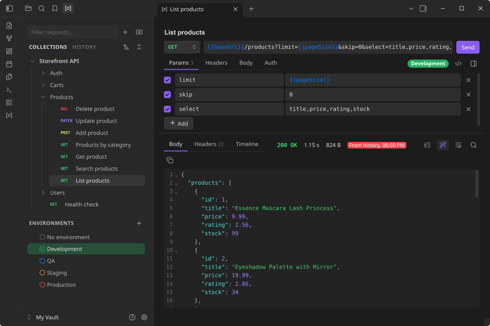
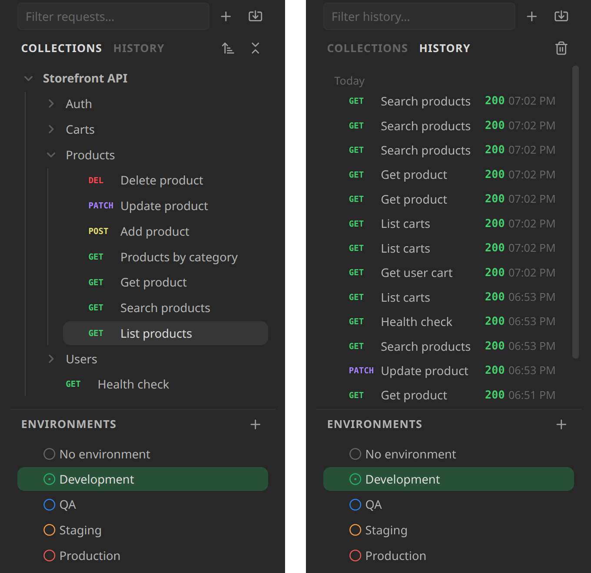
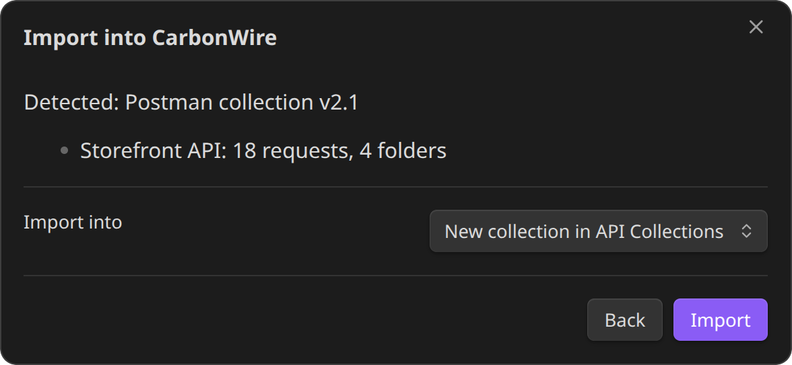

# CarbonWire

**A fast REST API client for Obsidian.** Send HTTP requests, inspect responses and keep your API collections right next to your notes. Bring your collections over from Postman, Insomnia and Bruno, or just paste a curl command.

CarbonWire is free and open source, under the MIT license. Also [available for VS Code](#also-for-vs-code).



## Why CarbonWire

- **Fast.** The sidebar indexes 5,000 requests in under 5 ms and filters them as you type. Big JSON responses are formatted in the background, so Obsidian stays responsive.
- **Your files, your vault.** Collections are plain YAML files in the OpenCollection format that Bruno uses. They sync, diff and version like the rest of your notes, and Bruno's YAML collections open as they are.
- **Bring everything with you.** Import from Postman, Insomnia, Bruno, HTTPie, Hoppscotch, curl, HAR and `.http` files, environments included, or a whole Postman account in one go.
- **Everything you reach for.** OAuth 2.0 sign-in in the browser, AWS, NTLM and eight more auth types, cookies, proxies, client certificates, HTTP/2, code snippets and a console that shows each request as it was sent.
- **Private by design.** No account, no cloud, no telemetry. Requests go only where you send them, and secrets stay in Obsidian's secret storage.
- **Open source.** All the code is [on GitHub](https://github.com/carbonconfig/CarbonWire_Obsidian) under the MIT license, so you can see exactly what it does with your requests.

## Quick start

1. Select the CarbonWire icon in the ribbon to open your collections.
2. Select **+ → New request**, or **Import** to bring in a Postman, Insomnia or Bruno collection.
3. Type a URL, or paste a curl command, and press `Ctrl/Cmd + Enter`.
4. Select **Save** to keep the request in a collection. From then on, changes save automatically.

## Features

**Requests**
- Any method, query and path parameters, headers, and JSON, XML, text, form, multipart or file bodies
- `{{variables}}` everywhere, shown in blue when defined and red when not, plus Postman's dynamic values: `{{$guid}}`, `{{$timestamp}}`, `{{$randomEmail}}` and about 120 more
- Auth: Basic, Bearer token, API key, Digest, OAuth 2.0 (authorization code with PKCE, implicit, client credentials and password), OAuth 1.0, AWS Signature v4, NTLM, Hawk, Akamai EdgeGrid, JWT Bearer, ASAP and WSSE. Authorization code and implicit sign in through your browser.
- Settings for each request, folder or collection: timeout, redirects (how many, keeping the method or the Authorization header), URL encoding, HTTP/1.1 or HTTP/2, certificate checks, TLS versions and cipher suites, cookies, and which default headers to send
- Paste a curl command into the URL bar and the whole request fills in. Copy any request back out as curl.
- The request as code: cURL, raw HTTP, JavaScript `fetch`, Python `requests` or Go
- Header presets: save a set of headers once and add it to any request
- Comment out lines of a JSON body with `Ctrl+/` (`Cmd+/`). Commented lines aren't sent.
- A request opens on the first of Body, Params, Auth and Headers that has something in it, and each tab comes back as you left it: its tabs, response view and JSONPath filter
- Start a request in a new tab without saving it, then save it to a collection when you want to keep it

**Responses**
- Status, time and size at a glance, with live progress while connecting, waiting and downloading, and a button to cancel a slow request
- Pretty-printed, searchable JSON with syntax colouring, and a JSON tree view for large payloads
- Filter JSON with JSONPath, such as `$.items[?@.active].id`
- HTML preview, images and PDFs right in the panel
- Headers, cookies, a timing breakdown (DNS, connect, TLS, waiting and download), and the connection: address, TLS version, cipher and the certificate chain
- Save a response body to a file, or keep it with the request as a saved example

**Collections and environments**
- Collections and folders share variables, headers, auth and settings with every request inside them, and can have docs, written in Markdown
- Globals: variables for every collection, whichever environment is active
- Hover an item in the sidebar to see where it's saved. Its menu copies the full path or shows it in your system's file explorer.
- One list of environments, one active at a time, each with its own colour, shown beside the request name and on the Send button. Names like dev, test, staging and prod get matching colours automatically.
- Drag to reorder or move requests, folders, collections and environments. Sort by name, creation or last update.

**History and the console**
- Every request you send is kept with its response, saved or not
- Open a request and its last response is already there
- Kept on this device only, never synced
- The console shows each request as it went out, after variables, auth, cookies and redirects, with what came back

**Network**
- A cookie jar: cookies responses set are sent with later requests to the same site. See and edit them in the cookie manager.
- Proxies: HTTP, HTTPS and SOCKS5, with a user name and password, set for CarbonWire or taken from the environment
- Client certificates for mutual TLS, per host (PEM or PKCS #12), and your own certificate authorities

**Export**
- Collections as Postman v2.1 JSON, Postman v3 YAML, an OpenCollection zip, a cURL script or HAR. Environments as Postman JSON or YAML. You choose where the file goes, outside the vault.

<p align="center"></p>

## Performance

| Task | Time |
|---|---|
| Index 5,000 requests for the sidebar | under 5 ms |
| Filter 5,000 requests as you type | under 1 ms |
| Sort 5,000 requests by name | about 1 ms |
| Import a Postman collection with 1,000 requests | under 10 ms |
| Pretty-print a 2.7 MB JSON response | about 25 ms, off the main thread |
| Build JSON tree rows for 25,000 objects | under 5 ms |
| Time added to each request over Node's own HTTP client | under 10 µs |
| Plugin size | 530 KB, nothing downloaded at runtime |

Median times on an Intel Core i5-1135G7 laptop with Node 24. Run `npm run bench` to measure on your machine.

## Import from

| Source | What comes across |
|---|---|
| Postman | Collections (v1, v2.0 and v2.1), environments, globals, and a whole data export (the .zip, or its folder) |
| Insomnia | v4 JSON and v5 YAML exports, with environments |
| Bruno | `.bru` collections and OpenCollection YAML folders |
| HTTPie | Desktop and web exports |
| Hoppscotch | Collections and environments |
| curl | Any command, pasted or imported |
| HAR | Browser network exports |
| `.http` files | JetBrains HTTP Client and VS Code REST Client, with `http-client.env.json` |

<p align="center"></p>

Auth that OpenCollection files have no place for (Hawk, Akamai EdgeGrid, JWT Bearer and ASAP) and a few of Postman's request settings are kept beside the collection in `.carbonwire/collection.json`, which CarbonWire for VS Code reads too. Other apps send those requests without that auth.

## Keyboard shortcuts

| Action | Shortcut |
|---|---|
| Send the request | `Ctrl/Cmd + Enter`, or `Enter` in the URL bar |
| Save an unsaved request | `Ctrl/Cmd + S` |
| Find in the response or body | `Ctrl/Cmd + F` |
| Comment out JSON body lines | `Ctrl/Cmd + /` |
| Cancel a request in flight | `Escape` in the response pane |

Commands in the palette: **Open collections**, **New request**, **Import collection, environment or cURL**, **Send request**, **Edit globals**, **Open console**, **Manage cookies** and **Clear OAuth 2.0 tokens**. Assign your own hotkeys to any of them.

## Settings

| Setting | Default | What it does |
|---|---|---|
| Collections folder | `API Collections` | Where new collections are created. Existing collections are found anywhere in the vault. |
| Environments folder | `API Collections/Environments` | Where environments are kept. They're shared by every collection. Follows the folder when you move or rename it in Obsidian. |
| Response size limit | 20 MB | Larger bodies are cut short in memory; the full size is still shown. |
| History size | 100 | How many recent requests to keep. Set to 0 to turn history off. |
| Wrap long lines in responses | On | Wraps long lines instead of scrolling sideways. Also on the response toolbar. |
| Verify TLS certificates | On | Turn off only for local servers with self-signed certificates. |
| Proxy | No proxy | From the environment (`HTTP_PROXY`, `HTTPS_PROXY`, `NO_PROXY`), or a custom HTTP, HTTPS or SOCKS5 proxy with hosts that skip it. Its password is kept in Obsidian's secret storage. |
| Client certificates | | One per line: a host such as `api.example.com` or `*.example.com`, then a PEM certificate and key, or a `.p12` or `.pfx` file. Passphrases are kept in Obsidian's secret storage. |
| Certificate authorities | | PEM files of certificate authorities to trust besides your system's, one per line. |

## Install

In Obsidian, open **Settings → Community plugins → Browse**, search for **CarbonWire**, then select **Install** and **Enable**. You can also install it from [CarbonWire's page](https://community.obsidian.md/plugins/carbonwire) in Obsidian's community plugins.

CarbonWire needs Obsidian 1.11.4 or later, on desktop.

## Also for VS Code

CarbonWire is also a VS Code extension, with the same features. It works in Cursor, Windsurf, VSCodium and other editors based on VS Code too. Both use the same plain YAML files, so a collection made in one opens in the other.

- [VS Code Marketplace](https://marketplace.visualstudio.com/items?itemName=carbonconfig.carbonwire)
- [Open VSX](https://open-vsx.org/extension/carbonconfig/carbonwire), for Cursor, Windsurf and VSCodium
- [Source on GitHub](https://github.com/carbonconfig/CarbonWire_VSCode)

## Privacy and network use

- CarbonWire sends requests only to the URLs you enter, and only when you send them. For OAuth 2.0 it also calls the token URL you set, including when you copy a request as curl. Through a proxy you set, requests go to the proxy.
- For OAuth 2.0 authorization code and implicit sign-in, CarbonWire opens the provider's page in your browser and listens on `127.0.0.1` for the redirect, on the callback URL's port or any free one, until the sign-in finishes or 5 minutes pass.
- There's no telemetry and no account.
- A request body can be a file anywhere on your computer, such as `-F file=@/path/to/report.pdf` in an imported curl command. CarbonWire reads that file only when you send the request, and never writes outside your vault.
- Secret environment values, the proxy password and certificate passphrases are kept in Obsidian's secret storage, never in your vault.
- Client certificates and certificate authorities are read from the files you name in the settings, when you first send a request.
- Cookies are kept for this vault on this device, never synced. Delete them in the cookie manager.
- Header presets and the auth and settings OpenCollection files can't hold are written in `.carbonwire/` folders in your vault.
- History, including response bodies up to 1 MB each, stays on this device. Requests are stored as written, so secrets aren't copied into history. Clear it from the History tab or turn it off in settings.
- HTML previews run no scripts and load nothing from the network.

## Coming next

- [ ] JSON validation in the body editor, with mistakes marked where they are
- [ ] Run a request once for each row of a CSV file or pasted list, with assertions to check every response
- [ ] GraphQL
- [ ] gRPC
- [ ] WebSocket and server-sent events
- [ ] OpenAPI import
- [ ] Pre-request and test scripts, with a collection runner
- [ ] Code snippets for more languages
- [ ] Mobile support

## Development

Requires Node 24 (`nvm use`).

```sh
npm install
npm run dev      # rebuild main.js and styles.css on change
npm test         # unit and transport tests
npm run bench    # performance benchmarks
npm run lint
npm run build    # type-check and production build
npm run analyze  # production build with a size breakdown
```

To try a build, link the repository into a vault's `.obsidian/plugins/carbonwire` folder and enable CarbonWire under Community plugins.

## License

CarbonWire is open source under the [MIT license](LICENSE). Bug reports and ideas are welcome in [GitHub issues](https://github.com/carbonconfig/CarbonWire_Obsidian/issues).
