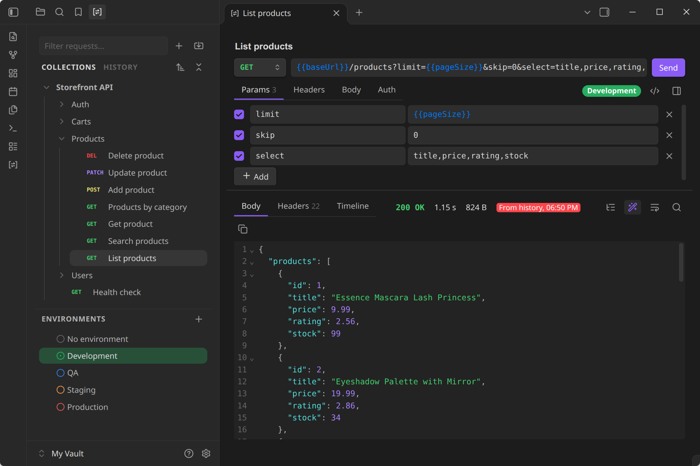
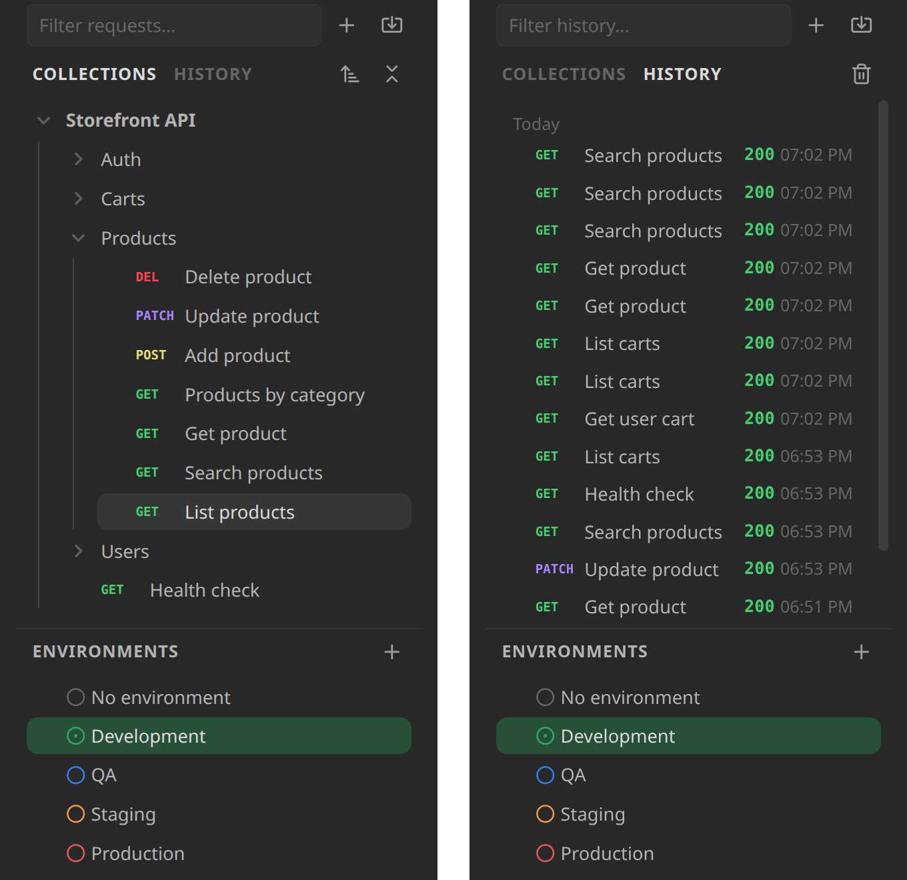
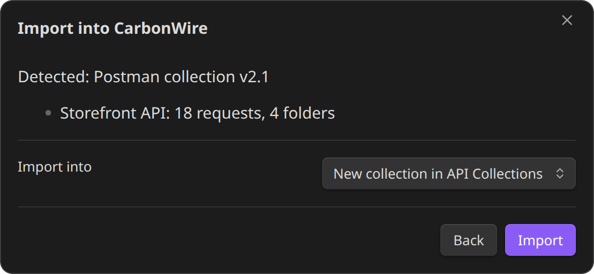

# CarbonWire

**A fast REST API client for Obsidian.** Send HTTP requests, inspect responses and keep your API collections right next to your notes. Bring your collections over from Postman, Insomnia and Bruno, or just paste a curl command.



## Why CarbonWire

- **Fast.** The sidebar indexes 5,000 requests in under 5 ms and filters them as you type. Big JSON responses are formatted in the background, so Obsidian stays responsive.
- **Your files, your vault.** Collections are plain YAML files in the OpenCollection format that Bruno uses. They sync, diff and version like the rest of your notes, and Bruno's YAML collections open as they are.
- **Bring everything with you.** Import from Postman, Insomnia, Bruno, HTTPie, Hoppscotch, curl, HAR and `.http` files, environments included.
- **Private by design.** No account, no cloud, no telemetry. Requests go only where you send them, and secrets stay in Obsidian's secret storage.

## Quick start

1. Select the CarbonWire icon in the ribbon to open your collections.
2. Select **+ → New request**, or **Import** to bring in a Postman, Insomnia or Bruno collection.
3. Type a URL, or paste a curl command, and press `Ctrl/Cmd + Enter`.
4. Select **Save** to keep the request in a collection. From then on, changes save automatically.

## Features

**Requests**
- Any method, query and path parameters, headers, and JSON, XML, text, form, multipart or file bodies
- `{{variables}}` everywhere, shown in blue when defined and red when not, plus dynamic values like `{{$guid}}` and `{{$timestamp}}`
- Auth: Basic, Bearer token, API key, Digest and OAuth 2.0 (client credentials and password)
- Paste a curl command into the URL bar and the whole request fills in. Copy any request back out as curl.
- Start a request in a new tab without saving it, then save it to a collection when you want to keep it

**Responses**
- Status, time and size at a glance, with live progress while connecting, waiting and downloading
- Pretty-printed, searchable JSON with syntax colouring, and a JSON tree view for large payloads
- HTML preview, images and PDFs right in the panel
- Headers and a timing breakdown: DNS, connect, TLS, waiting and download

**Collections and environments**
- Collections and folders share variables, headers and auth with every request inside them
- One list of environments, one active at a time, each with its own colour. Names like dev, test, staging and prod get matching colours automatically.
- Drag to reorder or move requests, folders, collections and environments. Sort by name, creation or last update.

**History**
- Every request you send is kept with its response, saved or not
- Open a request and its last response is already there
- Kept on this device only, never synced

<p align="center"></p>

## Performance

| Task | Time |
|---|---|
| Index 5,000 requests for the sidebar | under 5 ms |
| Filter 5,000 requests as you type | under 1 ms |
| Sort 5,000 requests by name | about 1 ms |
| Import a Postman collection with 1,000 requests | under 10 ms |
| Pretty-print a 2.7 MB JSON response | about 25 ms, off the main thread |
| Build JSON tree rows for 25,000 objects | under 5 ms |
| Time added to each request over Node's own HTTP client | under 10 µs |
| Plugin size | 385 KB, nothing downloaded at runtime |

Median times on an Intel Core i5-1135G7 laptop with Node 24. Run `npm run bench` to measure on your machine.

## Import from

| Source | What comes across |
|---|---|
| Postman | Collections (v2.0 and v2.1) and environments |
| Insomnia | v4 JSON and v5 YAML exports, with environments |
| Bruno | `.bru` collections and OpenCollection YAML folders |
| HTTPie | Desktop and web exports |
| Hoppscotch | Collections and environments |
| curl | Any command, pasted or imported |
| HAR | Browser network exports |
| `.http` files | JetBrains HTTP Client and VS Code REST Client, with `http-client.env.json` |

<p align="center"></p>

## Keyboard shortcuts

| Action | Shortcut |
|---|---|
| Send the request | `Ctrl/Cmd + Enter`, or `Enter` in the URL bar |
| Save an unsaved request | `Ctrl/Cmd + S` |
| Find in the response or body | `Ctrl/Cmd + F` |

Commands in the palette: **Open collections**, **New request**, **Import collection, environment or cURL** and **Send request**. Assign your own hotkeys to any of them.

## Settings

| Setting | Default | What it does |
|---|---|---|
| Collections folder | `API Collections` | Where new collections are created. Existing collections are found anywhere in the vault. |
| Environments folder | `API Collections/Environments` | Where environments are kept. They're shared by every collection. |
| Response size limit | 20 MB | Larger bodies are cut short in memory; the full size is still shown. |
| History size | 100 | How many recent requests to keep. Set to 0 to turn history off. |
| Wrap long lines in responses | On | Wraps long lines instead of scrolling sideways. Also on the response toolbar. |
| Verify TLS certificates | On | Turn off only for local servers with self-signed certificates. |

## Install

In Obsidian, open **Settings → Community plugins → Browse**, search for **CarbonWire**, then select **Install** and **Enable**.

CarbonWire needs Obsidian 1.11.4 or later, on desktop.

## Privacy and network use

- CarbonWire sends requests only to the URLs you enter, and only when you send them. For OAuth 2.0 it also calls the token URL you set, including when you copy a request as curl.
- There's no telemetry and no account.
- A request body can be a file anywhere on your computer, such as `-F file=@/path/to/report.pdf` in an imported curl command. CarbonWire reads that file only when you send the request, and never writes outside your vault.
- Secret environment values are kept in Obsidian's secret storage, never in your vault.
- History, including response bodies up to 1 MB each, stays on this device. Requests are stored as written, so secrets aren't copied into history. Clear it from the History tab or turn it off in settings.
- HTML previews run no scripts and load nothing from the network.

## Coming next

- [ ] Request settings: timeout, redirects and URL encoding
- [ ] Export to Postman and OpenCollection
- [ ] GraphQL
- [ ] gRPC
- [ ] WebSocket and server-sent events
- [ ] OpenAPI import
- [ ] Pre-request and test scripts, with a collection runner
- [ ] Cookies, proxies and client certificates
- [ ] OAuth 2.0 authorization code with PKCE
- [ ] Code snippets for other languages
- [ ] Mobile support

## Development

Requires Node 24 (`nvm use`).

```sh
npm install
npm run dev      # rebuild main.js and styles.css on change
npm test         # unit and transport tests
npm run bench    # performance benchmarks
npm run lint
npm run build    # type-check and production build
npm run analyze  # production build with a size breakdown
```

To try a build, link the repository into a vault's `.obsidian/plugins/carbonwire` folder and enable CarbonWire under Community plugins.

## License

[MIT](LICENSE)
